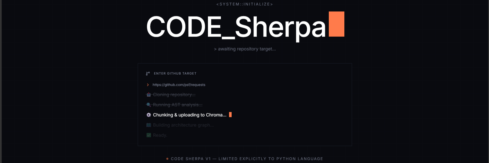
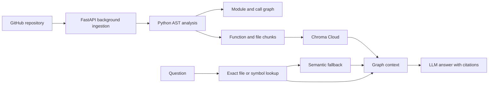

<div align="center">



# 🧭 CODE Sherpa

### Ask a codebase a question. Get an answer grounded in how its code is actually connected.

CODE Sherpa maps repository structure, follows real function relationships, and retrieves focused code context for an LLM to explain, with citations you can open.

<br/>

[](https://code-sherpa-mu.vercel.app/)
[](https://github.com/GoLu-Jii/CODE_Sherpa)


<br/>

[**Results**](#-results) · [**How it works**](#-how-it-works) · [**Features**](#-features) · [**Try it**](#-try-it) · [**Run locally**](#-run-locally) · [**Roadmap**](#-roadmap)

</div>

<br/>

> **Currently supports Python-based repositories.**

<br/>

## ⚡ The short version

Most code chat tools search snippets by semantic similarity. CODE Sherpa first builds a map from the source itself: **modules, functions, imports, and resolved calls**. It uses that map to find exact symbols and files, then follows relevant graph relationships. Semantic retrieval is the fallback, not the starting point.

The LLM explains the retrieved code and attaches citations you can open.

<div align="center">

| 🎯 Exact before semantic | 🕸️ Relationships stay visible | 🔎 Answers are inspectable |
| :---: | :---: | :---: |
| File and symbol lookups use AST metadata first | Imports and resolved calls add downstream context | Every citation opens the real source |

</div>

<br/>

<div align="center">

[](https://code-sherpa-mu.vercel.app/)

*Click the screenshot to open the live demo.*

</div>

<br/>

## 📊 Results

<div align="center">

| 🧪 Benchmark | ✅ Sherpa result | 📏 Compared with |
| :--- | :---: | :--- |
| Function-level questions (15 queries) | **44.7% fewer prompt tokens** | Full contents of the relevant files |
| Mixed benchmark (30 queries) | **23.2% fewer prompt tokens** | Full contents of the relevant files |
| Local retrieval (20 queries) | **0.12 s average** | Retrieval only; excludes LLM inference |

</div>

In the mixed token benchmark, Sherpa sent fewer tokens on **18 of 30 queries**. Savings depend on the question: broad module-level questions can need more context than the full-file baseline. The strongest savings come from asking about a specific function or symbol, where exact AST matches avoid sending unrelated code.

<details>
<summary><b>📐 How these numbers were measured</b></summary>

<br/>

- `bm_tokens_v2.py` ran 30 questions through the real retriever and counted prompt tokens with `tiktoken` (`cl100k_base`). Its baseline used the full contents of each file containing a retrieved chunk. The percentages above compare the aggregate token totals for each group.
- `bm_latency_v2.py` measured retrieval for 20 questions against the local persistent Chroma collection. The **0.12 s** figure is the mean of the recorded retrieval times; it does not include the LLM call, network latency, or deployed-server overhead.
- The benchmark scripts, query set, and per-query CSV outputs are included in this repository: [`bm_tokens_v2.py`](./bm_tokens_v2.py), [`bm_tokens_v2.csv`](./bm_tokens_v2.csv), [`bm_latency_v2.py`](./bm_latency_v2.py), [`bm_latency_v2.csv`](./bm_latency_v2.csv), and [`queries.txt`](./queries.txt).

</details>

<br/>

## 🧠 How it works



| Step | What happens |
| :--- | :--- |
| **1 · Parse structure** | The AST analyzer extracts Python modules, classes, functions, imports, and call relationships. A lightweight assignment tracker resolves common cross-file method calls without running repository code. |
| **2 · Ingest useful units** | The chunker creates function-level and file-level records with AST-derived identifiers and graph metadata. Chroma Cloud stores and retrieves them. |
| **3 · Retrieve by intent** | The retriever recognizes file and symbol questions for exact lookup, adds known graph dependencies, and uses semantic search when no deterministic match is found. |
| **4 · Explain with evidence** | The LLM gets the retrieved code and graph context. Responses cite source nodes, and the UI connects citations to the repository browser. |

<br/>

<div align="center">


</div>

<br/>

## 🤔 Why the AST matters

An embedding can find code that *sounds* related. It cannot prove that a function calls another function, or that a symbol belongs to a particular file. CODE Sherpa keeps those structural facts grounded in parsed source.

| | Embedding-only code chat | **CODE Sherpa** |
| :--- | :--- | :--- |
| Finds a named function | Nearest-neighbour guess | **Exact AST match first** |
| Knows who calls what | Inferred from text similarity | **Resolved call graph** |
| Context sent to the LLM | Snippets or whole files | **Focused function + graph neighbours** |
| Can you verify the answer? | Hard | **Citations open the source** |
| Fallback | n/a | **Semantic search when no exact match** |

<br/>

## ✨ Features

- **Exact before semantic.** File and symbol lookups use AST metadata first; vector search is the fallback.
- **Graph-aware context.** Imports and resolved calls form a graph that adds relevant downstream code to the answer context.
- **Traceable citations.** Citations point to retrieved code nodes, and the UI lets you open the corresponding source.
- **Non-blocking ingestion.** FastAPI queues repository processing and exposes job status for polling, so the request never hangs on a clone.
- **No code execution.** Repositories are analyzed statically with Python's `ast`; nothing from the target repo is run.

<br/>

## 🚀 Try it

<div align="center">

### **[▶ Launch the live demo](https://code-sherpa-mu.vercel.app/)** · **[📂 Browse the source](https://github.com/GoLu-Jii/CODE_Sherpa)**

</div>

Paste a public GitHub URL containing Python code. Once ingestion completes, ask questions like:

```text
What does `backend/app/api/gitclone.py` do?
What does `build_unified_model` do?
Who calls `retrieve_with_graph_context`?
```

Select a citation to jump to its source. The current analyzer is scoped to Python repositories.

<br/>

## 🛠️ Tech stack

| Area | Tools | Role |
| :--- | :--- | :--- |
| **Frontend** | React, Vite | Chat UI and repository browser |
| **API and ingestion** | FastAPI, background jobs | Clone, analyze, and expose job status |
| **Code structure** | Python `ast`, custom dependency and call resolution | Modules, functions, imports, resolved calls |
| **Retrieval** | Chroma Cloud, exact AST lookup, semantic fallback, graph traversal | Pick the smallest useful context |
| **Answer generation** | Groq API, configurable through environment variables | Explain retrieved code with citations |

<br/>

## 💻 Run locally

<details>
<summary><b>Expand setup instructions</b></summary>

<br/>

### Requirements

- Python 3.8 or newer
- Node.js LTS and npm
- Chroma Cloud credentials
- A Groq API key for answer generation

### Backend

```bash
git clone https://github.com/GoLu-Jii/CODE_Sherpa
cd CODE_Sherpa
python -m venv .venv
source .venv/bin/activate   # Windows: .venv\Scripts\Activate.ps1
pip install -r requirements.txt
```

Create a root `.env` file with your credentials:

```dotenv
CHROMA_API_KEY=your_chroma_api_key
CHROMA_TENANT=your_chroma_tenant
CHROMA_DATABASE=your_chroma_database
GROQ_API_KEY=your_groq_api_key
# Optional: GROQ_MODEL=qwen/qwen3.8-27b
```

```bash
cd backend
python -m uvicorn app.server:app --reload
```

The API runs at `http://localhost:8000`.

### Frontend

In a second terminal:

```bash
cd frontend
npm install
```

Copy `frontend/.env.example` to `frontend/.env`, set `VITE_API_BASE_URL=http://localhost:8000`, then run:

```bash
npm run dev
```

The frontend runs at `http://localhost:5173`.

</details>

<br/>

## 🧪 Tests and benchmarks

| File | Purpose |
| :--- | :--- |
| `tests/test_retriever.py` | File-query parsing, basename matching, and exact file retrieval with a dummy collection |
| `tests/test_real_rag.py` | Manual integration script: retrieval and answer generation against an already-ingested Chroma Cloud collection (needs the configured database and LLM credentials) |
| `tests/verify.py` | Manual local check of analysis, chunking, and retrieval using a local Chroma collection |
| `bm_tokens_v2.py` · `bm_latency_v2.py` | Reproduce the prompt-size and latency measurements. They use the local `chroma_data/` collection and the query set in `queries.txt` |

<br/>

## 🛣️ Roadmap

- [ ] Support for languages beyond Python
- [ ] Isolated collections per repository or user for concurrent sessions
- [ ] Trace call chains between selected functions

<br/>

## 👤 Author

Built by **[Gaurav Joshi](https://github.com/GoLu-Jii)** for **Hack The Winter 2025**.

## 📜 License

Apache License 2.0. See [`LICENSE`](./LICENSE).

<div align="center">

<br/>

**If CODE Sherpa helped you understand a codebase faster, consider giving it a ⭐**

</div>
