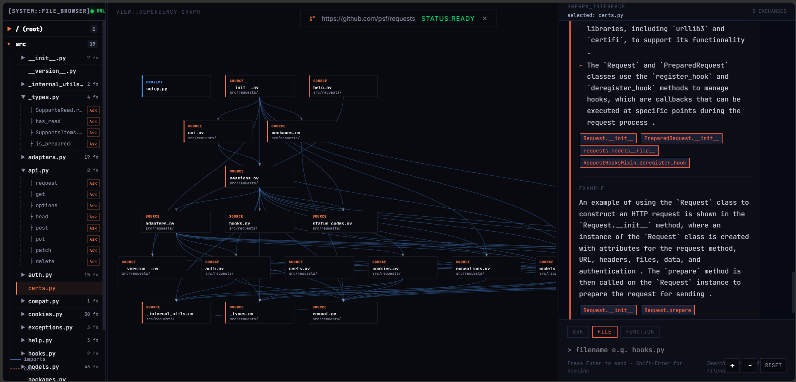
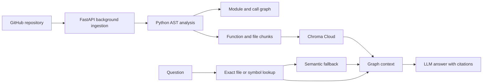
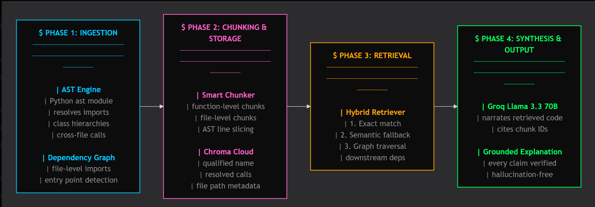

<div align="center">


# CODE Sherpa

**Ask a codebase a question. Get an answer grounded in how its code is actually connected.**

CODE Sherpa parses a Python repository into a graph of modules, functions, imports and calls, retrieves focused code context from that graph, and has an LLM explain it with citations you can open.

[](https://code-sherpa-mu.vercel.app/)
[](./LICENSE)

[Results](#results) | [How it works](#how-it-works) | [Try it](#try-it) | [Run locally](#run-locally) | [Roadmap](#roadmap)

</div>

Currently supports Python-based repositories.

[](https://code-sherpa-mu.vercel.app/)

## Overview

Most code chat tools search snippets by semantic similarity. CODE Sherpa first builds a map from the source itself: modules, functions, imports and resolved calls. It uses that map to find exact symbols and files, then follows relevant graph relationships. Semantic retrieval is the fallback.

An embedding can find code that sounds related, but it cannot prove that one function calls another or that a symbol belongs to a particular file. Those structural facts come from parsed source here, not from similarity scores.

## Results

| Benchmark | Result | Compared with |
| --- | ---: | --- |
| Function-level questions (15 queries) | 44.7% fewer prompt tokens | Full contents of the relevant files |
| Mixed benchmark (30 queries) | 23.2% fewer prompt tokens | Full contents of the relevant files |
| Local retrieval (20 queries) | 0.12 s average | Retrieval only; excludes LLM inference |

In the mixed benchmark, Sherpa sent fewer tokens on 18 of 30 queries. Savings depend on the question: broad module-level questions can need more context than the full-file baseline. The strongest savings come from asking about a specific function or symbol, where exact AST matches avoid sending unrelated code.

<details>
<summary>How these numbers were measured</summary>

- `bm_tokens_v2.py` ran 30 questions through the real retriever and counted prompt tokens with `tiktoken` (`cl100k_base`). Its baseline used the full contents of each file containing a retrieved chunk. The percentages compare aggregate token totals for each group.
- `bm_latency_v2.py` measured retrieval for 20 questions against the local persistent Chroma collection. The 0.12 s figure is the mean of the recorded retrieval times. It does not include the LLM call, network latency, or deployed-server overhead.
- The scripts, query set and per-query CSV outputs are in this repository: [`bm_tokens_v2.py`](./bm_tokens_v2.py), [`bm_tokens_v2.csv`](./bm_tokens_v2.csv), [`bm_latency_v2.py`](./bm_latency_v2.py), [`bm_latency_v2.csv`](./bm_latency_v2.csv) and [`queries.txt`](./queries.txt).

</details>

## How it works



1. **Parse structure.** The AST analyzer extracts Python modules, classes, functions, imports and call relationships. A lightweight assignment tracker resolves common cross-file method calls without running repository code.
2. **Ingest useful units.** The chunker creates function-level and file-level records with AST-derived identifiers and graph metadata. Chroma Cloud stores and retrieves them.
3. **Retrieve by intent.** The retriever recognizes file and symbol questions for exact lookup, adds known graph dependencies, and uses semantic search when no deterministic match is found.
4. **Explain with evidence.** The LLM receives the retrieved code and graph context. Responses cite source nodes, and the UI connects citations to the repository browser.

Ingestion does not block the request: FastAPI queues repository processing and exposes job status for polling.



## Try it

[Live demo](https://code-sherpa-mu.vercel.app/) | [Source](https://github.com/GoLu-Jii/CODE_Sherpa)

Paste a public GitHub URL containing Python code. Once ingestion completes, ask about a file, function or call relationship, for example:

- "What does `backend/app/api/gitclone.py` do?"
- "What does `build_unified_model` do?"
- "Who calls `retrieve_with_graph_context`?"

Select a citation to jump to its source.

## Tech stack

| Area | Tools |
| --- | --- |
| Frontend | React, Vite |
| API and ingestion | FastAPI, background jobs |
| Code structure | Python `ast`, custom dependency and call resolution |
| Retrieval | Chroma Cloud, exact AST lookup, semantic fallback, graph traversal |
| Answer generation | Groq API, configurable through environment variables |

## Run locally

<details>
<summary>Setup instructions</summary>

### Requirements

- Python 3.8 or newer
- Node.js LTS and npm
- Chroma Cloud credentials
- A Groq API key for answer generation

### Backend

```bash
git clone https://github.com/GoLu-Jii/CODE_Sherpa
cd CODE_Sherpa
python -m venv .venv
source .venv/bin/activate   # Windows: .venv\Scripts\Activate.ps1
pip install -r requirements.txt
```

Create a root `.env` file with your credentials:

```dotenv
CHROMA_API_KEY=your_chroma_api_key
CHROMA_TENANT=your_chroma_tenant
CHROMA_DATABASE=your_chroma_database
GROQ_API_KEY=your_groq_api_key
# Optional: GROQ_MODEL=qwen/qwen3.8-27b
```

```bash
cd backend
python -m uvicorn app.server:app --reload
```

The API runs at `http://localhost:8000`.

### Frontend

In a second terminal:

```bash
cd frontend
npm install
```

Copy `frontend/.env.example` to `frontend/.env`, set `VITE_API_BASE_URL=http://localhost:8000`, then run:

```bash
npm run dev
```

The frontend runs at `http://localhost:5173`.

</details>

## Tests and benchmarks

- `tests/test_retriever.py` covers file-query parsing, basename matching and exact file retrieval with a dummy collection.
- `tests/test_real_rag.py` is a manual integration script that exercises retrieval and answer generation against an already-ingested Chroma Cloud collection. It expects the configured database and LLM credentials.
- `tests/verify.py` is a manual local check of analysis, chunking and retrieval using a local Chroma collection.
- `bm_tokens_v2.py` and `bm_latency_v2.py` reproduce the prompt-size and latency measurements. They use the local `chroma_data/` collection and the query set in `queries.txt`.

## Roadmap

- [ ] Support languages beyond Python
- [ ] Isolate collections per repository or user for concurrent sessions
- [ ] Trace call chains between selected functions

## Author

Built by [Gaurav Joshi](https://github.com/GoLu-Jii) for Hack The Winter 2025.

## License

Apache License 2.0. See [`LICENSE`](./LICENSE).
