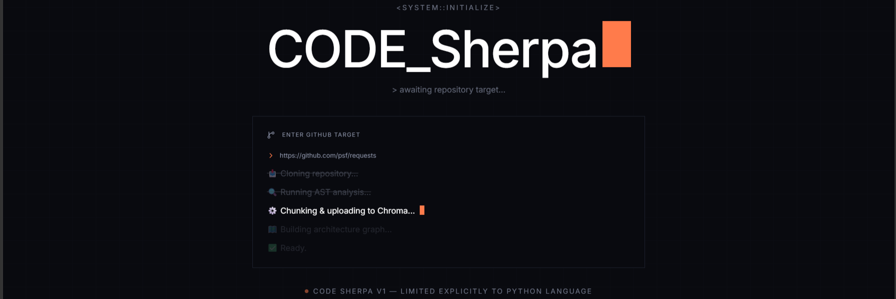
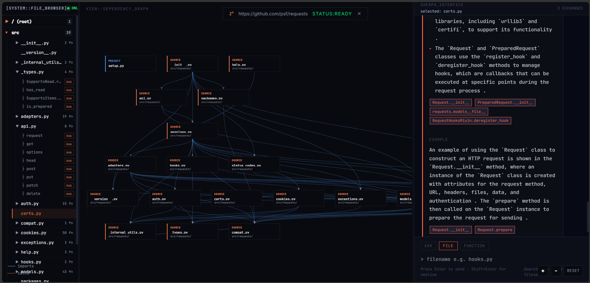
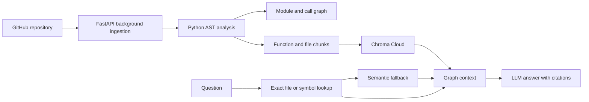
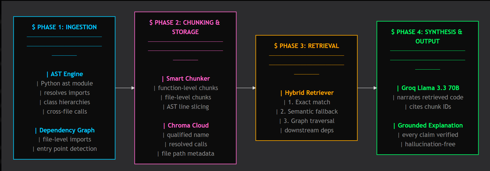

# CODE Sherpa

> **Ask a codebase a question. Get an answer grounded in how its code is actually connected.**
>
> CODE Sherpa maps repository structure, follows real function relationships, and retrieves focused code context for an LLM to explain. In a 30-query benchmark, its hybrid retrieval used **23.2% fewer prompt tokens overall** and **44.7% fewer for function-level questions** than sending the full contents of relevant files. **Currently supports Python-based repositories.**

[](https://code-sherpa-mu.vercel.app/)


**Python · FastAPI · React · Python AST · Chroma Cloud · Hybrid Retrieval**

<p align="center">
  <a href="#results">See the measurements</a> ·
  <a href="#how-it-works">How it works</a> ·
  <a href="#try-it">Open the demo</a> ·
  <a href="#run-locally">Run it locally</a>
</p>



## The short version

Most code chat tools search snippets by semantic similarity. CODE Sherpa first builds a map from the source itself: modules, functions, imports, and resolved calls. It uses that map to find exact symbols and files, then follows relevant graph relationships; semantic retrieval is the fallback. The LLM explains retrieved code and attaches citations you can open.

**The result:** code answers you can trace back to actual files and functions, with measured prompt savings on a 30-query benchmark.

## Results

| Benchmark | Sherpa result | Compared with |
| --- | ---: | --- |
| Function-level questions (15 queries) | **44.7% fewer prompt tokens** | Full contents of the relevant files |
| Mixed benchmark (30 queries) | **23.2% fewer prompt tokens overall** | Full contents of the relevant files |
| Local retrieval (20 queries) | **0.12 s average** | Retrieval only; excludes LLM inference |

In the mixed token benchmark, Sherpa sent fewer tokens on **18 of 30 queries**. The savings depend on the question: broad module-level questions can need more context than the full-file baseline. The strongest savings come from asking about a specific function or symbol, where exact AST matches avoid sending unrelated code.

<details>
<summary>How these numbers were measured</summary>

- `bm_tokens_v2.py` ran 30 questions through the real retriever and counted prompt tokens with `tiktoken` (`cl100k_base`). Its baseline used the full contents of each file containing a retrieved chunk. The percentages above compare the aggregate token totals for each group.
- `bm_latency_v2.py` measured retrieval for 20 questions against the local persistent Chroma collection. The **0.12 s** figure is the mean of the recorded retrieval times; it does not include the LLM call, network latency, or deployed-server overhead.
- The benchmark scripts, query set, and per-query CSV outputs are included in this repository: [`bm_tokens_v2.py`](./bm_tokens_v2.py), [`bm_tokens_v2.csv`](./bm_tokens_v2.csv), [`bm_latency_v2.py`](./bm_latency_v2.py), [`bm_latency_v2.csv`](./bm_latency_v2.csv), and [`queries.txt`](./queries.txt).

</details>

## See CODE Sherpa

[](https://code-sherpa-mu.vercel.app/)

Open the demo, paste a public GitHub repository URL with Python code, wait for ingestion, then ask about a file, function, or call relationship. Select a citation to jump to its source.

## How it works



1. **Parse structure.** The AST analyzer extracts Python modules, classes, functions, imports, and call relationships. A lightweight assignment tracker resolves common cross-file method calls without running repository code.
2. **Ingest useful units.** The chunker creates function-level and file-level records with AST-derived identifiers and graph metadata. Chroma Cloud stores and retrieves them.
3. **Retrieve by intent.** The retriever recognizes file and symbol questions for exact lookup, adds known graph dependencies, and uses semantic search when no deterministic match is found.
4. **Explain with evidence.** The LLM gets the retrieved code and graph context. Responses cite source nodes, and the UI connects citations to the repository browser.

## Why the AST matters

An embedding can find code that sounds related. It cannot prove that a function calls another function or that a symbol belongs to a particular file. CODE Sherpa keeps those structural facts grounded in parsed source:

- **Exact before semantic.** File and symbol lookups use AST metadata first; vector search is the fallback.
- **Relationships stay visible.** Imports and resolved calls form a graph that can add relevant downstream code to the answer context.
- **Answers are inspectable.** Citations point to retrieved code nodes, and the UI lets you open the corresponding source.
- **Ingestion does not block the request.** FastAPI queues repository processing and exposes job status for polling.

## Project

Built by [Gaurav Joshi](https://github.com/GoLu-Jii) for **Hack The Winter 2025**. CODE Sherpa is a Python-focused code understanding tool with a React frontend and a FastAPI analysis and retrieval backend.

| Area | Tools |
| --- | --- |
| Frontend | React, Vite |
| API and ingestion | FastAPI, background jobs |
| Code structure | Python `ast`, custom dependency and call resolution |
| Retrieval | Chroma Cloud, exact AST lookup, semantic fallback, graph traversal |
| Answer generation | Groq API, configurable through environment variables |

## Try it

**[Launch the live demo](https://code-sherpa-mu.vercel.app/)** · **[Browse the source](https://github.com/GoLu-Jii/CODE_Sherpa)**

Paste a public GitHub URL containing Python code. Once ingestion completes, ask questions such as:

- “What does `backend/app/api/gitclone.py` do?”
- “What does `build_unified_model` do?”
- “Who calls `retrieve_with_graph_context`?”

The current analyzer is scoped to Python repositories.

## Run locally

<details>
<summary>Expand setup instructions</summary>

### Requirements

- Python 3.8 or newer
- Node.js LTS and npm
- Chroma Cloud credentials
- A Groq API key for answer generation

### Backend

```bash
git clone https://github.com/GoLu-Jii/CODE_Sherpa
cd CODE_Sherpa
python -m venv .venv
source .venv/bin/activate   # Windows: .venv\Scripts\Activate.ps1
pip install -r requirements.txt
```

Create a root `.env` file with your credentials:

```dotenv
CHROMA_API_KEY=your_chroma_api_key
CHROMA_TENANT=your_chroma_tenant
CHROMA_DATABASE=your_chroma_database
GROQ_API_KEY=your_groq_api_key
# Optional: GROQ_MODEL=qwen/qwen3.8-27b
```

```bash
cd backend
python -m uvicorn app.server:app --reload
```

The API runs at `http://localhost:8000`.

### Frontend

In a second terminal:

```bash
cd frontend
npm install
```

Copy `frontend/.env.example` to `frontend/.env`, set `VITE_API_BASE_URL=http://localhost:8000`, then run:

```bash
npm run dev
```

The frontend runs at `http://localhost:5173`.

</details>

## Tests and benchmarks

- `tests/test_retriever.py` covers file-query parsing, basename matching, and exact file retrieval with a dummy collection.
- `tests/test_real_rag.py` is a manual integration script that exercises retrieval and answer generation against an already-ingested Chroma Cloud collection; it expects the configured database and LLM credentials.
- `tests/verify.py` is a manual local analysis/chunking/retrieval check using a local Chroma collection.
- `bm_tokens_v2.py` and `bm_latency_v2.py` reproduce the prompt-size and latency measurements described above. They use the local `chroma_data/` collection and the query set in `queries.txt`.

## Architecture



## Next

- Add support for languages beyond Python.
- Isolate collections per repository or user for concurrent sessions.
- Trace call chains between selected functions.

## License

Apache License 2.0. See [`LICENSE`](./LICENSE).
